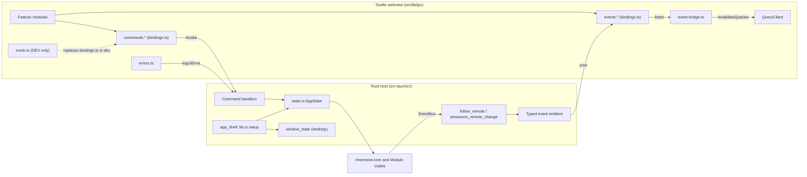

# Tauri Host and IPC Bridge

## Purpose

`Tauri_Host_and_IPC_Bridge` is the seam between Mnemora's Svelte webview and its Rust core. It has two halves:

- **Rust host (`src-tauri/src`)**: starts the app, runs migrations in a fixed order, holds shared `AppState`, registers the typed commands and events, and restores the main window's geometry.
- **Webview bridge (`src/lib/ipc`)**: holds the generated command and event bindings, turns Rust events into TanStack Query invalidations, reports frontend errors, and provides a DEV-only browser mock of the Rust side.

Business rules live in the domain crates. This module only wires them together and moves data across the boundary.

## Architecture

## Key flows

- **Startup.** `lib.rs::setup` runs the environment guard, then logging, then the device file, then the database and migrations, then Module hooks. Only after that does it create `AppState`, start Sync if it is enabled, and create the main window.
- **Command round trip.** A feature module calls `commands.*`, which invokes a thin Rust handler. The handler returns `Result<T, AppError>`, and `typedError` maps it to `{ status, data | error }`. Feature modules never call `invoke` directly.
- **Remote change.** Sync or the widget writes to the database and publishes on the core `EventBus`. `follow_remote` converts each message into a typed event. `event-bridge.ts` then invalidates the `todo`, `journal` or `ai` query keys.
- **Editing holds and deep links.** While an editor is open, `editing_hold` queues remote changes for that field. `mnemora://` links go through a bounded queue in `links.rs`, which the UI drains with `app_take_links`.

## Core component documentation

- [app_shell](Tauri_Host_and_IPC_Bridge/app_shell.md): Tauri startup order, `AppState`, the command and event registry, remote fan-out, editing holds, deep links and the environment guard.
- [ipc-bridge](Tauri_Host_and_IPC_Bridge/ipc-bridge.md): the webview side of the boundary, including generated bindings, `typedError`, the event bridge and frontend error reporting.
- [ipc-mock-backend](Tauri_Host_and_IPC_Bridge/ipc-mock-backend.md): the browser-only mock that answers commands and events in development, kept in step with Rust through shared JSON fixtures.
- [window_state](Tauri_Host_and_IPC_Bridge/window_state.md): desktop-only save and restore of the main window's size and position, debounced into `device.toml`.