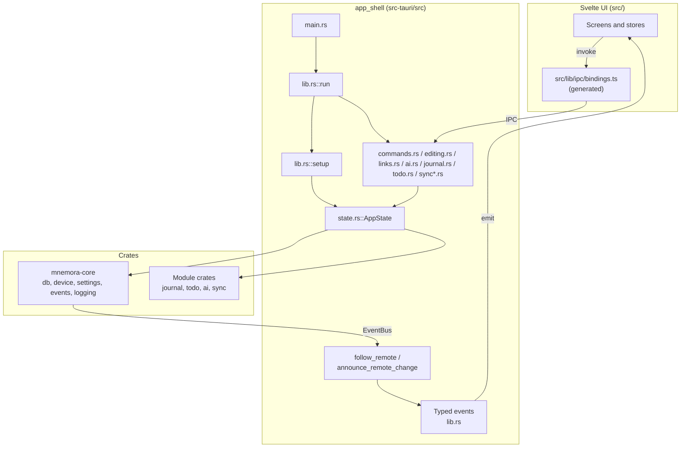
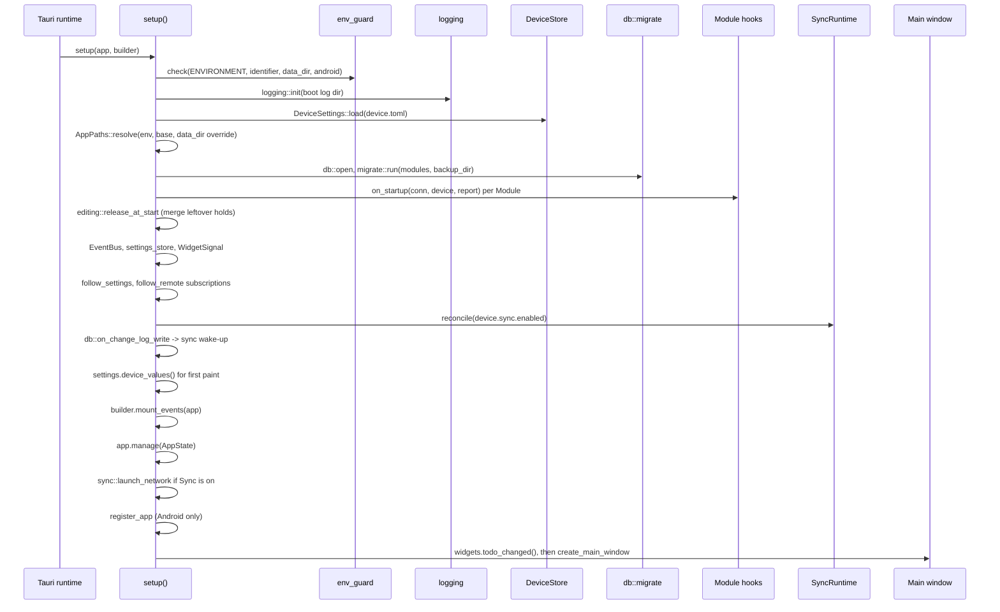
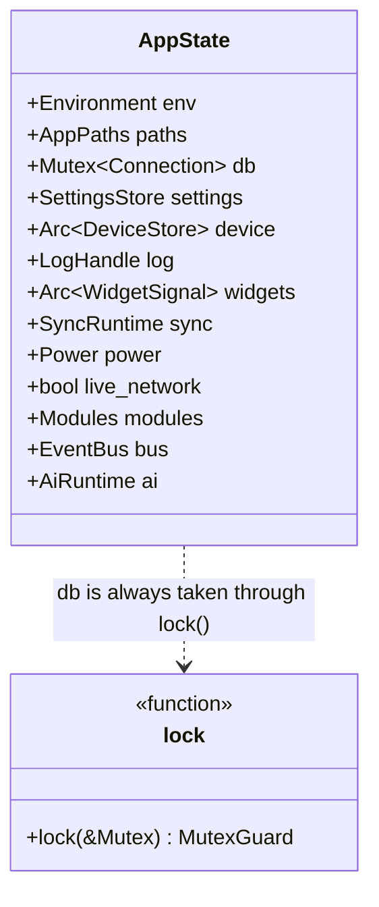
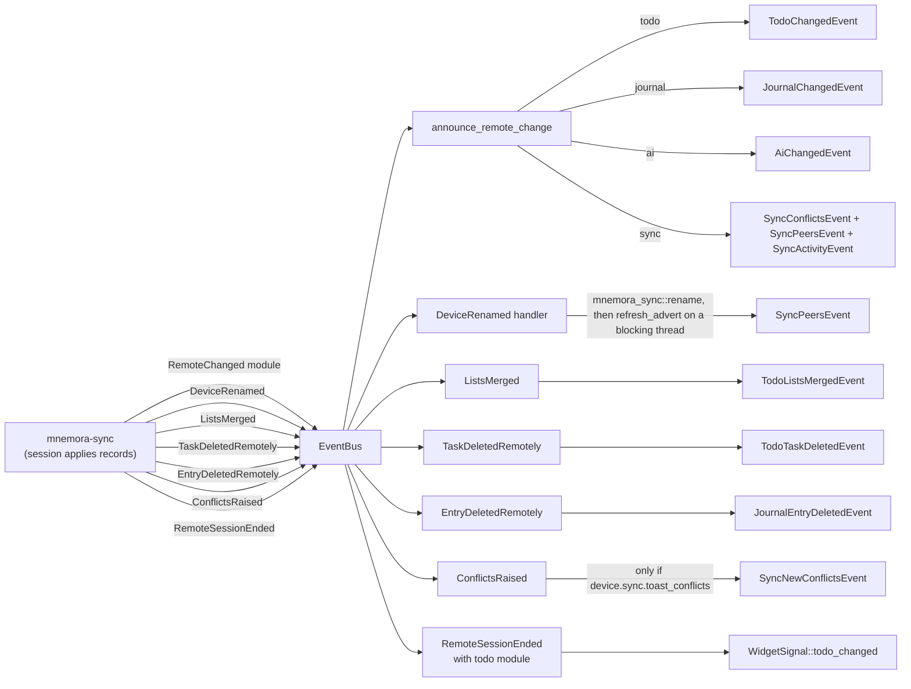
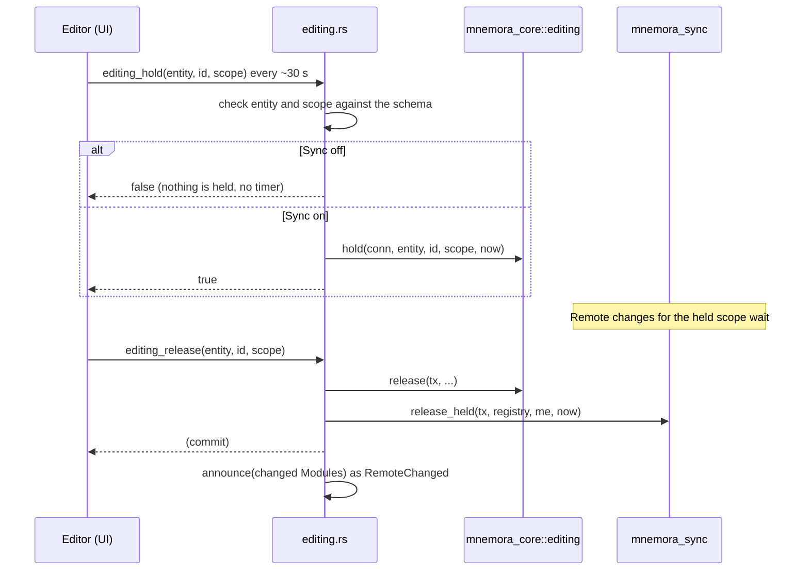
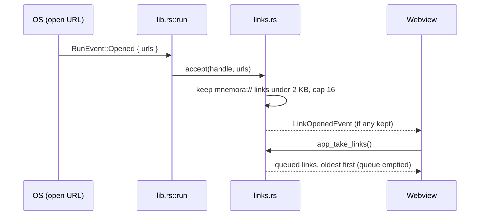

# app_shell

The `app_shell` module is the Tauri host of Mnemora. It lives in `src-tauri/src/` and does one job: it wires the `mnemora-core` and Module crates into a running Tauri application. It owns process startup, database migration order, the shared `AppState`, the list of IPC commands and typed events, the link queue for `mnemora://` links, the editing holds from the UI, and the rules that refuse to mix Sandbox and Production data. Business logic belongs in the crates, not here. Every command in this module is intentionally thin.

For the typed IPC surface that the UI calls, see [ipc-bridge](ipc-bridge.md). For the window geometry handling, see [window_state](window_state.md). For the data rules that the migrations apply, see [Data_Foundation](../Data_Foundation.md). For Android-specific entry points, see [Android_Integration](../Android_Integration.md).

## Responsibilities

| Concern | Where it is handled |
|---|---|
| Process entry and Tauri builder | `main.rs::main`, `lib.rs::run` |
| Startup order (env, logs, device file, DB, migrations, hooks) | `lib.rs::setup` |
| Shared runtime state | `state.rs::AppState`, `state.rs::lock` |
| IPC command and event registry | `lib.rs::specta_builder_for` |
| Typed events emitted to the webview | `lib.rs` event structs, `lib.rs::follow_remote`, `lib.rs::announce_remote_change` |
| Settings and device-file commands | `commands.rs` |
| Editing holds from the UI | `editing.rs` |
| `mnemora://` link queue | `links.rs` |
| Sandbox vs. Production guard | `env_guard.rs::check` |
| Main window creation with theme first paint | `lib.rs::create_main_window` |

## Architecture

The host has three layers:

1. **Entry.** `main.rs` calls `mnemora_lib::run()`. `run` builds the Tauri application, registers the opener plugin, manages `PendingLinks`, installs the invoke handler generated from the specta builder, and runs `setup`.
2. **Host services.** `AppState` holds everything commands need: the single SQLite connection behind a mutex, the settings store, the device store, logging, the widget signal, the Sync runtime, the Sync power state, the list of Modules, the event bus, and the AI runtime.
3. **Commands and events.** Commands are `#[tauri::command]` functions registered through `tauri_specta`. Events are typed structs that implement `tauri_specta::Event`. Both are exported to TypeScript.

## Startup sequence

`lib.rs::setup` is the only place where the process is brought up. The order matters and is part of the contract.

Key points visible in the code:

- **Environment guard first.** `env_guard::check` runs before anything touches data. A Sandbox build running with the Production identifier, or the reverse, fails setup. On Android the check uses the data directory, because the package identifier cannot differ between the two builds.
- **Logging before everything else.** Logging starts before the device file is read, so a corrupt `device.toml` is recorded.
- **Migrations before Module hooks.** `db::migrate::run` applies every Module's migrations in the order given by `modules()` (Core, Journal, Todo, AI, Sync). Only after that does each Module's `on_startup` run, and a failing hook is logged and does not stop the app.
- **Holds are released at start.** Any editing hold left by a previous process is merged, because its editor died with it.
- **Sync is opt-in at runtime.** `SyncRuntime::reconcile` and `sync::launch_network` run only when the device file has Sync enabled. With Sync off, no port is opened and nothing is announced.
- **First paint without the database.** Look and feel values come from the device file (`settings.device_values()`), so the theme script can be injected before the database is read.

Each Module's migrations and startup logic are described in its own documentation: see [Data_Foundation](../Data_Foundation.md), [Sync_Replication_Engine](../Sync_Replication_Engine.md), and [Task_and_Journal_Domain_Services](../Task_and_Journal_Domain_Services.md).

## Shared state

- `db` is the single connection. Every command takes it through `state::lock`, which recovers from a poisoned mutex. The comment in the code explains the reason: a panic in one command must not brick every command for the rest of the session.
- `live_network` is `true` in the app and `false` in tests. Tests start their own loopback network.
- `modules` is the same `Modules` list the Sync engine uses to reach each Module through the `Module` contract. See [Sync_Replication_Engine](../Sync_Replication_Engine.md).
- `bus` is the in-process `EventBus` from `mnemora-core`. The host subscribes to it and turns its messages into typed IPC events.

## Command and event registry

`specta_builder_for!` is a macro because `#[specta::specta]` cannot see a generic runtime parameter of an outer function. The same macro produces the builder for the real Wry runtime (`specta_builder`) and for the mock runtime used in tests. The builder:

- collects every command, including generic ones such as `ai_run_start::<$runtime>` and `open_log_dir::<$runtime>`;
- collects every typed event, including those defined in `lib.rs` and the Sync and Todo events;
- exports `src/lib/ipc/bindings.ts` in debug desktop builds (`export_bindings`), so the UI always matches the Rust types.

Commands are grouped by owner. The host itself owns the following:

| Group | Commands | Source |
|---|---|---|
| Settings and device | `settings_get_all`, `settings_save`, `device_get`, `device_set_sidebar`, `device_set_todo_open`, `device_set_log_level`, `device_set_spellcheck` | `commands.rs` |
| App facts and diagnostics | `app_info`, `log_ui_error`, `open_log_dir`, `backup_now` | `commands.rs` |
| Deep links | `app_take_links` | `links.rs` |
| Editing holds | `editing_hold`, `editing_release` | `editing.rs` |

Feature commands (`journal_*`, `todo_*`, `ai_*`, `sync_*`) are registered by the same builder but implemented in their own host modules. See [ipc-bridge](ipc-bridge.md) for the complete surface and the UI side.

### Typed events

Events are emitted to the webview. The host defines most of them directly in `lib.rs`:

| Event | Payload | Emitted when |
|---|---|---|
| `SettingsChangedEvent` | `SettingsChanged` | A setting is saved (bridged from core's `SettingsChanged`) |
| `TodoChangedEvent` | none | Todo data changed outside the app's own screens (the widget) |
| `JournalChangedEvent` | none | Sync changed Journal data from another device |
| `AiChangedEvent` | none | Sync changed AI data from another device |
| `TodoListsMergedEvent` | from/into list ids and names, device | Sync merged two Lists with the same name |
| `TodoTaskDeletedEvent` | task id, title, device | A Task was deleted on another device |
| `JournalEntryDeletedEvent` | entry id, page date, device | An Entry was deleted on another device |
| `SyncPairingEvent` | `PairingView` | The pairing sheet's state changed |
| `SyncPeersEvent` | none | A paired device's status changed |
| `SyncConflictsEvent` | none | A Conflict was raised, received or settled |
| `SyncActivityEvent` | none | The Activity log gained lines |
| `SyncNewConflictsEvent` | count, device | New conflicts arrived and this device is set to show a toast |
| `AiRunEvent` | run id, conversation id, `RunEvent` | Each step of an AI Run |
| `LinkOpenedEvent` | none | A `mnemora://` link opened a running app |

The `events` list in `specta_builder_for!` is the authoritative registry; the table above is a summary.

## Remote change fan-out

Core publishes messages on its `EventBus`. `lib.rs::follow_remote` subscribes once at startup and translates each message into an IPC event. This is the only bridge between the crates and the webview for remote changes.

Behaviour worth knowing when maintaining this code:

- **Quiet by default.** `ConflictsRaised` is forwarded only when the device is set to show a toast. Otherwise nothing is emitted.
- **Widget redraws once per session.** The Todo widget is signalled on `RemoteSessionEnded`, not per batch, so a large sync does not flood it. The screens, by contrast, refresh after every batch through `RemoteChanged`.
- **Device renames are written before the session continues.** The rename handler saves the new name to the device file synchronously. Advertising the new name can wait for the network, so it runs on `spawn_blocking`, and the window is told before and after.
- **Sync announcements are composite.** A `RemoteChanged` for the Sync module fans out to three events, because a rename changes the Devices list and the Activity list at once.

Settings that change the Todo widget's drawing are followed separately with `widget::signal::follow_settings`.

## Editing holds

The Journal editor and the Task sheet call `editing_hold` while they are open and `editing_release` when their text is saved. A hold tells Sync to queue incoming changes for that record or field until the editor finishes, so a remote edit cannot replace text the person is typing.

Rules enforced in `editing.rs`:

- The entity id and scope are limited to 64 bytes.
- The scope must be the whole record (`editing::WHOLE`) or a field or field group named in the entity's schema. Anything else is a validation error.
- A hold lapses after two minutes without a renewal, so a vanished editor cannot block sync forever. `release_lapsed` runs when the app returns to the foreground, and `release_at_start` runs at startup.

The hold itself is stored by `mnemora-core`. See [Sync_Replication_Engine](../Sync_Replication_Engine.md) for how held changes are merged.

## Deep links

`links.rs` implements the path from a `mnemora://` link (from the Todo widget's taps) to the UI:

- Links are accepted only if they start with `mnemora://`, are at most 2,048 bytes, and the queue holds at most 16. The oldest link is dropped when the queue is full.
- The queue is managed before `setup` runs, because a cold start can deliver a link before the UI listens.
- On macOS, iOS and Android, `lib.rs::run` forwards `RunEvent::Opened` URLs to `links::accept`.
- If the queue gains entries, `LinkOpenedEvent` tells a running UI to call `app_take_links`. The event carries no payload, so a link is read exactly once.

## Environment separation

Sandbox and Production are separate builds with separate data. This module makes the separation a startup invariant:

- `ENVIRONMENT` is chosen at compile time by the `sandbox` Cargo feature. There is no runtime switch.
- `env_guard::check` compares the Tauri config identifier with the build's expected identifier on desktop, and the Android data directory on Android. A mismatch aborts setup with an "environment mismatch" error.
- The main window title is changed to "Mnemora Sandbox" in Sandbox builds.
- The AI key folder (`ai-keys`) lives under the config directory (`AI_KEYS_DIR`).

Build targets and feature flags that produce these builds are described in [Build_and_Packaging](../Build_and_Packaging.md).

## Commands in detail

### Settings and device

- `settings_get_all` returns the values and the schema for every registered key.
- `settings_save` applies a batch atomically and emits `SettingsChangedEvent` on success. Validation and unknown-key errors come from core.
- `device_get`, `device_set_sidebar`, `device_set_todo_open`, `device_set_log_level`, and `device_set_spellcheck` read or update `device.toml`. Sidebar width is clamped to 200–360 pixels. The log level is validated with `normalize_level` and applied to the running logger before it is saved.

Look-and-feel settings (theme, density, text size, reduce motion, phone tabs) live in the device file, not the database. The test suite in `commands.rs` covers the one-time upgrade that copies existing values out of the database.

### Logging and diagnostics

- `log_ui_error` writes a frontend error to the Rust log under the `ui` target. Message and stack are each capped at 8,000 characters.
- `open_log_dir` opens the log folder with the opener plugin.
- `app_info` returns the version, environment, data and log folders, and the OS account's first name. On mobile the name is empty. Placeholder names such as "Anonymous" or "Unknown" are treated as no name.

### Backup

`backup_now` takes a database backup into the backup folder and returns its path. Automatic backups are part of migration and are handled by `mnemora-core`; see [Data_Foundation](../Data_Foundation.md).

## Main window

`create_main_window` builds the window from the first window in `tauri.conf.json`:

1. The theme first-paint script is injected as an initialization script, built from the device-file look values.
2. On desktop, `window_state::restore` applies the saved geometry before the window is built, and `window_state::track` saves it when the window changes. See [window_state](window_state.md).
3. On mobile the window handle is not needed and is dropped.

## Testing

- `lib.rs` tests check that the generated bindings contain every command and event name the UI relies on. `regenerate_bindings` is an ignored test that rewrites `src/lib/ipc/bindings.ts`; `make bindings` runs it.
- `commands.rs` tests use `test_support::TestApp` to call commands the way the UI does (`TestApp::invoke`), and cover the look-and-feel upgrade, the phone tabs migration, validation errors, and first-name sanitising.
- `links.rs` tests cover ordering, scheme filtering, the 16-link cap, the length limit, and that a running app is told once per accepted link.
- `env_guard.rs` tests cover desktop identifier matching and Android data-directory matching across the two environments.

The shared test harness and the cross-module test suites are described in [Tauri_Host_and_IPC_Bridge](../Tauri_Host_and_IPC_Bridge.md) and the Module pages it links to.

## Maintenance notes

- **Adding a command.** Write a thin `#[tauri::command] #[specta::specta]` function, then add it to `specta_builder_for!`. Add its name to the bindings test in `lib.rs`. Regenerate bindings with `make bindings`.
- **Adding an event.** Define a struct that derives `Type` and `Event`, add it to `collect_events!`, and emit it from `follow_remote` or a command. Keep the payload free of rules; decide the rule in core.
- **Adding a Module.** Register it in `lib.rs::modules()`. Order matters: migrations run in this order, and the Sync engine and the Settings store read the same list. Also add a branch to `announce_remote_change` if it has screens that need remote refresh.
- **Locks.** Always take the database with `state::lock`. Do not hold the database lock while emitting events or while calling into the network; the Sync code in `state.sync.refresh_advert()` is run on a blocking thread for this reason.
- **Keep the host thin.** If a command starts validating business rules, move the rule to the owning crate and keep only the call in `commands.rs`.
