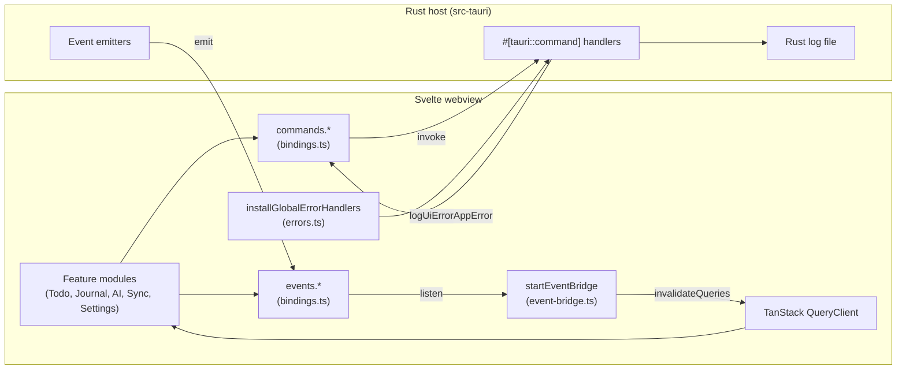
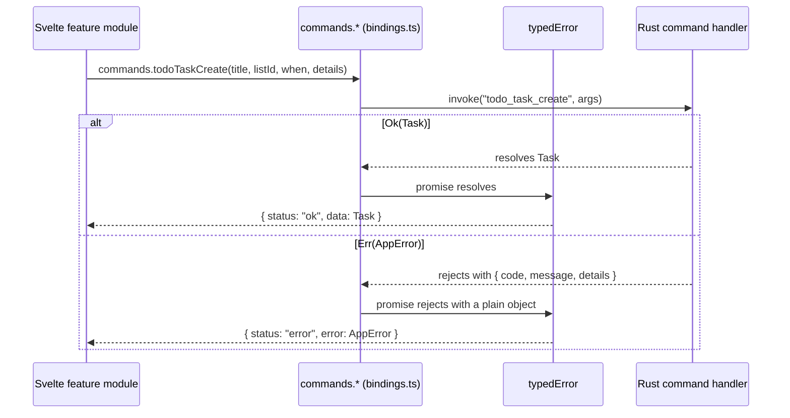
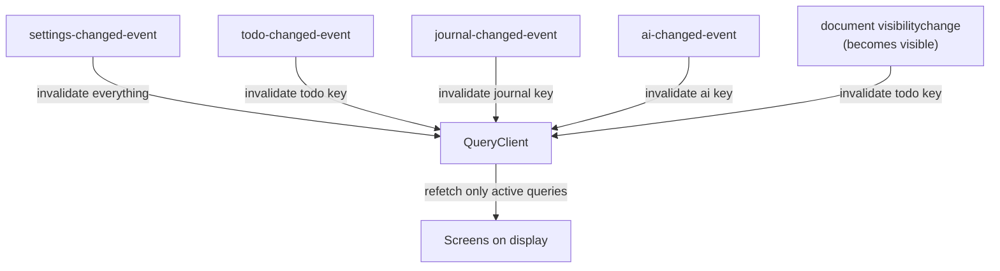
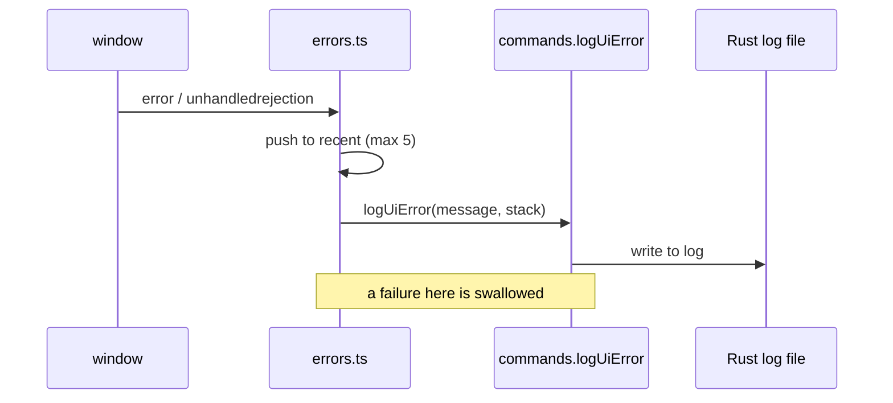
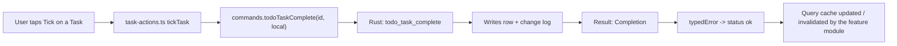

# IPC Bridge (`src/lib/ipc`)

The IPC bridge is the webview side of the Tauri boundary. It holds the generated command and event bindings, a small runtime that turns Rust results into typed values, the glue that turns Rust events into TanStack Query invalidations, and the browser-side error reporter. Everything the Svelte UI calls on the Rust host, or hears from it, goes through the files in this folder.

The Rust side of the same boundary (the command handlers, the `setup` hook and the event payload types) is documented in [Tauri Host and IPC Bridge](../Tauri_Host_and_IPC_Bridge.md) and [App Shell](app_shell.md). The browser mock that stands in for the Rust host in tests is described in [IPC Mock Backend](ipc-mock-backend.md).

## Files in scope

| File | Role |
|---|---|
| `src/lib/ipc/bindings.ts` | Generated by Tauri Specta. Exports `commands`, `events`, the TypeScript types for every Rust payload, and two runtime helpers: `typedError` and `makeEvent`. |
| `src/lib/ipc/event-bridge.ts` | `startEventBridge`: subscribes to the Rust events that matter to cached data and invalidates the matching TanStack Query keys. |
| `src/lib/ipc/event-bridge.test.ts` | Tests the listener registration, invalidation scope, and cleanup. |
| `src/lib/ipc/errors.ts` | `recentUiErrors` and `installGlobalErrorHandlers`: keeps the last few frontend errors and forwards them to the Rust log. |

Other files in the folder (`mock.ts`, `mock-*.ts` and their tests) are the browser mock. They are covered in [IPC Mock Backend](ipc-mock-backend.md).

## Architecture



The bindings file is the only place that names Tauri commands and events as strings. Feature modules never call `invoke` directly. The event bridge is the only place that maps Rust events onto cached query keys.

## Command bindings

`commands` is a plain object. Each entry is a function whose name is the camel-cased Rust command name. Two shapes exist, and the difference matters to callers.

### Result-wrapped commands

Commands that can fail return a `typedError` promise. Its result is one of two shapes:

```ts
type Result<T, E> =
  | { status: "ok"; data: T }
  | { status: "error"; error: E };
```

For commands with a Rust `Result<T, AppError>` return, `E` is `AppError`:

```ts
type AppError = {
  code: ErrorCode;     // validation | unknown_key | not_found | io | database | internal
  message: string;     // short, user-presentable
  details: string | null; // technical detail for "copy details"; never shown by default
};
```

Callers branch on `status` and never need `try/catch` for an expected failure.

### Plain commands

Some commands are read-only or cannot fail in a way the UI handles. They return the raw `invoke` promise, so a rejection would be an unwrapped `AppError` and must be caught by the caller. The plain commands are:

| Command | Returns |
|---|---|
| `deviceGet` | `DeviceSettings` |
| `appInfo` | `AppInfo` (version, environment, folders, OS first name) |
| `appTakeLinks` | `string[]`, links that opened the app since the last call |
| `logUiError` | `void`, forwards a frontend error to the Rust log |
| `aiRunAbort` | `void` |
| `syncPairState` | `PairingView` |
| `syncPairCancel`, `syncNow`, `syncResume`, `syncDeviceSyncNow` | `void` |
| `syncLocalNetworkOs` | `void`, reports the OS local-network permission |

### Typed command groups

Every other command is `typedError`-wrapped. The groups below list the bindings by domain. Each domain is documented in its own module page.

| Domain | Commands | Module doc |
|---|---|---|
| Settings and device | `settingsGetAll`, `settingsSave`, `deviceSetSidebar`, `deviceSetTodoOpen`, `deviceSetLogLevel`, `deviceSetSpellcheck`, `backupNow`, `openLogDir` | [Data Foundation](../Data_Foundation.md), [Shell and Navigation](../Shell_and_Navigation.md) |
| Editing holds | `editingHold`, `editingRelease` | [Sync Replication Engine](../Sync_Replication_Engine.md) |
| Journal | `journalEntryCreate`, `journalEntryUpdate`, `journalEntryToggleTask`, `journalEntryDelete`, `journalEntryRestore`, `journalEntryMove`, `journalMonthDays`, `journalPages`, `journalSearch`, `journalToday` | [Feature Client UI](../Feature_Client_UI.md), [Task and Journal Domain Services](../Task_and_Journal_Domain_Services.md) |
| AI | `aiRunStart`, `aiRunSteer`, `aiRunUnqueue`, `aiRunSendNow`, `aiRunRetry`, `aiConversationSetLeaf`, `aiConversationShowBranch`, `aiConversationGet`, `aiConversationList`, `aiConversationRename`, `aiConversationDelete`, `aiConversationRestore`, `aiConversationMarkdown`, `aiProviderList`, `aiProviderCreate`, `aiProviderUpdate`, `aiProviderDelete`, `aiProviderKeySet`, `aiProviderKeyClear`, `aiProviderTest`, `aiModelsSearch`, `aiModelsUsage`, `aiSavedList`, `aiSavedCreate`, `aiSavedUpdate`, `aiSavedDelete`, `aiSavedRestore`, `aiSavedReorder` | [AI Assistant Engine](../AI_Assistant_Engine.md) |
| Todo | Tasks: `todoTaskCreate`, `todoTaskQuickEdit`, `todoTaskQuickEditUndo`, `todoTaskComplete`, `todoTaskReopen`, `todoTaskSkip`, `todoTaskMove`, `todoTask`, `todoTaskUpdate`, `todoTaskSetPriority`, `todoTaskWontDo`, `todoTaskDelete`, `todoTaskRestore`, `todoTaskHistory`, `todoTaskSetWhen`, `todoTasksRestoreWhen`, `todoTasksMoveOverdue`, `todoTaskReorder`. Views: `todoInbox`, `todoToday`, `todoUpcoming`, `todoDone`, `todoAll`, `todoList`, `todoLists`, `todoCounts`, `todoDayCounts`. Lists: `todoListCreate`, `todoListRename`, `todoListSetEmoji`, `todoListDelete`, `todoListRestore`, `todoListReorder`, `todoListSetSort`, `todoListSetGroup`. Comments and search: `todoComments`, `todoCommentAdd`, `todoCommentEdit`, `todoCommentDelete`, `todoCommentRestore`, `todoSearch`, `todoParse` | [Task and Journal Domain Services](../Task_and_Journal_Domain_Services.md), [Feature Client UI](../Feature_Client_UI.md) |
| Sync | Status and devices: `syncGet`, `syncSetEnabled`, `syncRename`, `syncSetOption`, `syncLeave`, `syncDevices`, `syncDevice`, `syncDeviceRename`, `syncDeviceAddress`, `syncDeviceCheck`, `syncDeviceForget`, `syncLocalNetworkOs`, `syncOpenLocalNetworkSettings`. Pairing: `syncPairShow`, `syncPairNewCode`, `syncPairEnter`, `syncPairEnterAt`, `syncPairDecide`, `syncPairMerge`, `syncPairCancel`, `syncPairState`. Running: `syncNow`, `syncResume`. Conflicts and activity: `syncConflicts`, `syncConflict`, `syncConflictDraft`, `syncConflictResolve`, `syncResolutionUseOther`, `syncResolutionsVisited`, `syncAttention`, `syncActivity` | [Sync Connectivity and Pairing](../Sync_Connectivity_and_Pairing.md), [Sync Client Surface](../Sync_Client_Surface.md) |
| App | `appInfo`, `appTakeLinks`, `logUiError` | [Tauri Host and IPC Bridge](../Tauri_Host_and_IPC_Bridge.md) |

### Calling convention



Two details of `typedError` matter:

- A rejection that is a JavaScript `Error` is re-thrown. Tauri only produces plain objects for `AppError`, so a real `Error` means an unexpected runtime failure (for example, the bridge itself broke), which should surface as a crash rather than as a UI message.
- Plain-object rejections become `{ status: "error", error }`. The caller decides how to show `error.message`; `error.details` is for "copy details" only.

## Event bindings

`events` maps each Rust event to a `makeEvent` helper. Each helper gives three methods: `listen(cb)`, `once(cb)` and `emit(payload)`. Each also accepts a `Webview` or `Window` target so a listener can be bound to one window.

| Binding | Wire name | Payload | Meaning |
|---|---|---|---|
| `settingsChangedEvent` | `settings-changed-event` | `SettingsChanged { module, keys }` | A Preference or setting was saved |
| `todoChangedEvent` | `todo-changed-event` | `null` | Todo data changed outside the app's screens (the home-screen widget) |
| `journalChangedEvent` | `journal-changed-event` | `null` | Sync changed Journal data from another device |
| `aiChangedEvent` | `ai-changed-event` | `null` | Sync changed AI data from another device |
| `aiRunEvent` | `ai-run-event` | `AiRunEvent { run_id, conversation_id, event }` | One step of an AI Run, streamed live |
| `journalEntryDeletedEvent` | `journal-entry-deleted-event` | `{ entry_id, page_date, device }` | An open Entry was deleted elsewhere |
| `todoTaskDeletedEvent` | `todo-task-deleted-event` | `{ task_id, title, device }` | An open Task was deleted elsewhere |
| `todoListsMergedEvent` | `todo-lists-merged-event` | `{ from_id, from_name, into_id, into_name, device }` | Sync merged two same-named Lists |
| `linkOpenedEvent` | `link-opened-event` | `null` | A link opened the running app (widget taps); read with `appTakeLinks` |
| `syncActivityEvent` | `sync-activity-event` | `null` | The Activity log gained lines |
| `syncConflictsEvent` | `sync-conflicts-event` | `null` | A Conflict was raised or settled |
| `syncNewConflictsEvent` | `sync-new-conflicts-event` | `{ count, device }` | New Conflicts arrived on a device set to show a toast |
| `syncPairingEvent` | `sync-pairing-event` | `PairingView` | The pairing sheet's state changed |
| `syncPeersEvent` | `sync-peers-event` | `null` | A paired device's status or progress changed |

Payloads that are `null` are emitted without data. The `makeEvent` helper types `emit` accordingly, so a `null`-payload event takes no argument.

## Event bridge

`startEventBridge(client)` is the single place where Rust events cause cache refreshes. It is called once at startup with the app's `QueryClient`, and it returns an unlisten function.



Behaviour, taken from `event-bridge.ts`:

- **Settings change** invalidates every query. A Preference can change what any view shows, such as Done Tasks in Lists or the week start.
- **Todo widget write** invalidates only the `['todo']` key. The widget can also write while the app is stopped or its webview is paused, so Todo is also refetched whenever the page becomes visible again.
- **Sync changes to Journal and AI** invalidate `['journal']` and `['ai']`. The UI refreshes in place, with no toast.
- **Cache keys are conventions.** The bridge hard-codes `['todo']`, `['journal']` and `['ai']` as the first element of every query key in those modules. A query that does not start with its module's key will not refresh from these events.
- **Registration is all or nothing.** Listeners are registered one after another. If a later registration fails, the bridge removes the listeners already added and re-throws, so no listener leaks. The tests in `event-bridge.test.ts` cover a failure on the `todo` and on the `journal` listener.
- **Cleanup** removes the four listeners and the `visibilitychange` handler.

Events that the bridge does not handle (for example `aiRunEvent`, `syncPairingEvent`, `syncConflictsEvent`) are consumed directly by the feature modules that own those screens. They are not covered here; see [AI Assistant Engine](../AI_Assistant_Engine.md), [Sync Client Surface](../Sync_Client_Surface.md) and [Feature Client UI](../Feature_Client_UI.md).

## Frontend error reporting

`errors.ts` keeps the UI's own errors visible to the person and the log:

- `recentUiErrors()` returns the last five errors as `{ at, message }` records. It backs the "Copy diagnostics" action in Settings.
- `installGlobalErrorHandlers()` listens to `window` `error` and `unhandledrejection` events. Each one is stored in the ring buffer and forwarded with `commands.logUiError(message, stack)`.
- Reporting never raises a further error: the `logUiError` promise is `.catch`-ed silently.



## Generated code and how it is kept current

`bindings.ts` begins with "This file has been generated by Tauri Specta. Do not edit this file manually." The Makefile target `make bindings` regenerates it from the Rust `#[tauri::command]` and `#[specta::specta]` declarations in `src-tauri`. Changes to a command's signature must be made in Rust and regenerated, never in this file. The build and tooling entries are described in [Build and Packaging](../Build_and_Packaging.md); see `Makefile` and `package.json` for the exact targets.

Two generation limits are visible in the types and explain some odd-looking fields:

- `JsonValue` in the bindings is only a type for generation. On the wire, settings values stay `serde_json::Value`, because Specta cannot export recursive types or `i64`.
- `created_at` and similar instants are typed as `number` in TypeScript, because Specta refuses `i64`. Values stay below 2^53.

## Data flow for a typical round trip



The step labelled "Emit" shows that the event bridge is not on the path of an in-app write. The in-app mutation returns its result directly, and the feature module updates its own queries. The event bridge only handles writes that came from elsewhere (the widget, another device, or a Preference change).

## Dependencies and relationships

| This page uses | Why |
|---|---|
| [Tauri Host and IPC Bridge](../Tauri_Host_and_IPC_Bridge.md) | The Rust handlers and event emitters this bridge names |
| [App Shell](app_shell.md) | `setup` registers the handlers and event types; `app_take_links` and `log_ui_error` live here |
| [IPC Mock Backend](ipc-mock-backend.md) | Replaces `bindings.ts` in tests and in browser-only development |
| [Feature Client UI](../Feature_Client_UI.md) and [Shell and Navigation](../Shell_and_Navigation.md) | Callers of `commands.*` and listeners of `events.*` |

Feature modules depend on this folder, not the other way round. The only exception is `event-bridge.ts`, which knows the cache-key conventions of the Todo, Journal and AI modules.

## Testing

- `event-bridge.test.ts` mocks `./bindings` with an in-memory event registry and a fake `document`. It verifies scope of invalidation, visibility refetch, cleanup, and rollback on partial registration failure.
- Command behaviour is tested in the Rust test files named in the module tree, not here. The browser mock exercises the same command surface from the TypeScript side; see [IPC Mock Backend](ipc-mock-backend.md).

## Maintenance notes

- Do not add `invoke` calls outside `bindings.ts`. Add the Rust command, regenerate, and call `commands.*`.
- When a new event that should refresh cached data is added, register it in `startEventBridge`, add the matching `try/catch` unwind, and add a test in `event-bridge.test.ts`.
- When a new query key family is added to a feature module, its first element must be the module key, or the bridge will not reach it.
