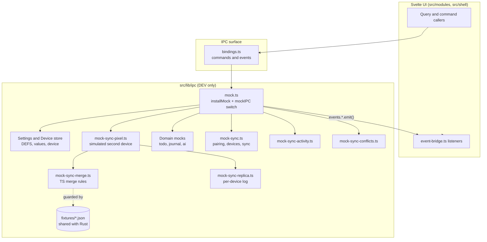
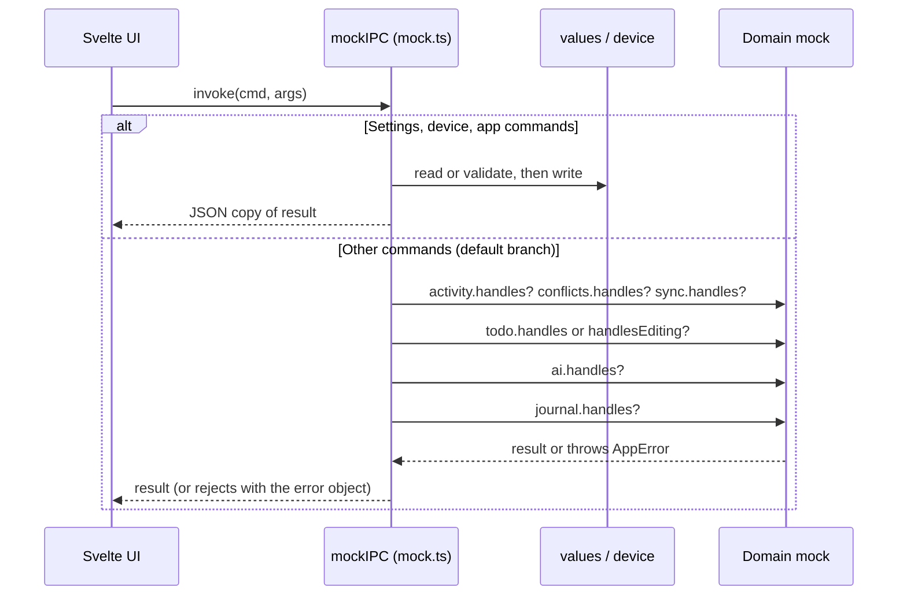
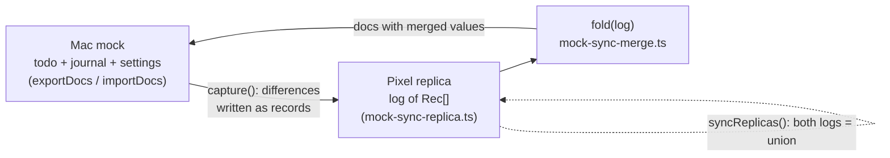

# IPC Mock Backend

The IPC mock backend is a browser-only stand-in for the Rust side of Mnemora. It lets the whole Svelte UI run at `http://localhost:47821` without Tauri: every `invoke` command and every backend event that the UI depends on is answered by TypeScript code in `src/lib/ipc/`. It is a development tool. `mock.ts` is loaded through a dynamic import guarded by `import.meta.env.DEV`, so it never reaches a production build (see [Vite build configuration](../Build_and_Packaging/vite_build_config.md)).

The mock is not a second implementation of the product. It is a faithful *simulation* of the Rust commands in [Tauri Host and IPC Bridge](../Tauri_Host_and_IPC_Bridge.md), the domain services in [Task and Journal Domain Services](../Task_and_Journal_Domain_Services.md), the [AI Assistant Engine](../AI_Assistant_Engine.md) and the [Sync Replication Engine](../Sync_Replication_Engine.md). Where a rule must match Rust exactly, the mock runs the same JSON fixture that a Rust test runs, so the two cannot silently drift (ADR 0009).

For the real IPC transport and typed bindings, see [IPC Bridge](ipc-bridge.md). For the UI that consumes these calls, see [Sync Client Surface](../Sync_Client_Surface.md), [Feature Client UI](../Feature_Client_UI.md) and [Shell and Navigation](../Shell_and_Navigation.md).

## What it does

| Responsibility | Where | Notes |
|---|---|---|
| Install the fake IPC layer | `src/lib/ipc/mock.ts` (`installMock`) | Calls `mockIPC` from `@tauri-apps/api/mocks` with `shouldMockEvents: true`, so `events.*.emit()` reaches the UI. |
| Device and app-level commands | `mock.ts` | `settings_get_all`, `settings_save`, `device_*`, `app_info`, `backup_now`, `log_ui_error`, `open_log_dir`, `app_take_links`. |
| Preferences with validation | `mock.ts` (`DEFS`, `oneOf`, `bool`, `text`, `list`) | Mirrors the Core settings schema; see [Core settings](../Data_Foundation/core_settings.md). |
| Look and feel kept per device | `mock.ts` (`LOOK_KEYS`) | Theme, density, text size, reduce motion and phone tabs live in the device file, not the database. |
| Journal | `mock-journal*.ts` | Entries, pages, search, remote-edit simulation. See [Journal](../Feature_Client_UI/journal.md). |
| Todo | `mock-todo*.ts` | Tasks, Lists, Comments, History, grouping, Done, capture parsing, search. See [Todo domain](../Task_and_Journal_Domain_Services/todo.md). |
| AI | `mock-ai.ts` | Conversations, Providers, runs with streamed events, Saved questions. See [AI Assistant](../AI_Assistant_Engine/ai_assistant.md). |
| Sync | `mock-sync*.ts` | Pairing, devices, Activity, Conflicts, a simulated second device and a TypeScript copy of the merge rules. See [Sync Connectivity and Pairing](../Sync_Connectivity_and_Pairing.md) and [Sync Replication Engine](../Sync_Replication_Engine.md). |
| Browser test seams | `mock.ts` (`window.__*`) | Console hooks used by QA and the Vitest suite. |

## Architecture

`mock.ts` is the only place that touches `mockIPC`. Every other mock is a factory (`createTodoMock`, `createJournalMock`, `createAiMock`, `createSyncMock`, `createActivityMock`, `createConflictsMock`, `createPixelMock`) that exposes `handles(cmd)` and `handle(cmd, args)`, so the top-level switch only routes by command name.

## Command routing

`installMock()` builds the state and then answers each command. The order below is the one in the `default:` branch of the switch:

Errors are thrown as plain `AppError` objects (`{ code, message, details }`), which is how the real IPC rejects. The `err()` helper in `mock.ts` builds them, and the domain mocks use their own `fail()` helpers with the same shape. Results are always JSON copies (`copy`, `JSON.parse(JSON.stringify(...))`) so that UI code cannot mutate the simulated database, matching real IPC.

### Settings validation

`DEFS` is the table of every Preference the mock accepts, with a default and a validator. `settings_save` validates every change in the batch before it writes any of them, and an unknown key or a bad value throws `validation`. Saving `core.phone_tabs` also sets `core.phone_tabs_edited`, as Rust does. Look-and-feel keys (`LOOK_KEYS`) are written to the device object, not `values`, because Rust keeps them in `device.toml`.

`settings_get_all` returns the values plus a schema list, and `settings_changed` events are emitted once per module with keys stripped of their module prefix, matching the Rust emitter.

### Events

The mock emits the same events the Rust host emits through the typed `events` object:

| Event | Emitted when |
|---|---|
| `settingsChangedEvent` | A setting is saved, or a synced preference arrives. |
| `todoChangedEvent`, `todoListsMergedEvent`, `todoTaskDeletedEvent` | Todo data changes, a List merges away, or a Task is deleted remotely. |
| `journalChangedEvent`, `journalEntryDeletedEvent` | Journal data changes, or an open Entry is deleted remotely. |
| `aiRunEvent` | Each event of a running AI answer (`runStarted`, `textDelta`, `stepStarted`, `entrySaved`, `queueChanged`, `runEnded`). |
| `syncActivityEvent`, `syncConflictsEvent`, `syncPeersEvent`, `syncPairingEvent`, `syncNewConflictsEvent` | The Sync pages need to refresh. |

`todoChangedEvent` and `journalChangedEvent` are how the mock tells open views to refresh, the browser counterpart of the Rust host's change events (see [App Shell](app_shell.md)).

## Components

### `mock.ts`: the entry point

- **`installMock()`** creates the device record and values, applies `?sync=on`, `?paired=N`, `?paused=`, `?localnet=` and `?paircode=` query options, constructs every domain mock, wires their callbacks to events, and finally calls `mockIPC`.
- **`applyPrePaintAttributes()`** sets the `data-theme`, `data-density`, `data-text-size`, `data-reduce-motion` and `data-env="sandbox"` attributes that Rust's window init script sets before first paint.
- **Held-edit clashes.** `todo.onHeldClash` and `journal.onHeldClash` raise a Conflict when the person typed in a field while a remote change waited, mirroring Rust's `held.rs` and `texts.rs`.
- **`__listMergeMock`** and **`__journalRemoteMock`** are console hooks that act out another device making a same-named List or editing an Entry.

### Validators shared by the mock

`oneOf`, `bool`, `text(max)` and `list(max)` build the `Validator` functions used by `DEFS`. Text length is counted in code points (`[...v].length`), as Rust counts characters.

### Domain mocks

Each domain mock is a closure over its own in-memory arrays and exposes `handle`/`handles`:

- **Todo** (`mock-todo.ts`): `createTodoMock(prefs)` keeps Tasks, Lists, Comments and a change log per Task. It exposes test seams `exportDocs()` / `importDocs()` (used by sync), `simulateMerge()`, `ops()`, and the editing hold commands (`editing_hold`, `editing_release`) for the Task sheet's `title` and `notes` fields. Helpers `mock-todo-arrange.ts`, `mock-todo-order.ts`, `mock-todo-parse.ts`, `mock-todo-search.ts`, `mock-todo-history.ts` and `mock-occurrence.ts` are imported by it. See [Todo domain](../Task_and_Journal_Domain_Services/todo.md) for the rules.
- **Journal** (`mock-journal.ts`, `mock-journal-search.ts`): Entries and pages, with `simulateRemoteEdit(text, id)` that waits for a held Entry, and `exportDocs()` / `importDocs()` for sync. Search matches by accent-free, case-free prefixes and requires every word, with a separate "similar" group for typos.
- **AI** (`mock-ai.ts`): demo Conversations (34, paged 30 at a time), three Saved questions, Providers of four kinds, and streamed runs. Trigger words in the question decide the outcome (for example "fail", "offline", "budget", "overdue"); the header of `mock-ai.ts` documents them. Titles, address rules, failure wording, Markdown copy and history search are checked against `fixtures/ai-*.json`.
- **Sync** (`mock-sync.ts`, `mock-sync-pairing.ts`, `mock-sync-live`-style state): the device list, pairing phases, Local Network permission, mobile-data pauses, the typed Address, Check, Forget, Rename, and attention counts. Pairing codes have fixed magic values (`12345678` succeeds, `11111111` is a wrong code, `20000000` expires, and so on; the table is in `mock-sync-pairing.ts`).
- **Activity** (`mock-sync-activity.ts`): a seeded log of about 4000 lines, paged newest first with `at:id` cursors, filtered by device, with sentences matching `activity_view.rs`. `describe()` turns each event into text as viewed from `this device`.
- **Conflicts** (`mock-sync-conflicts.ts`): needs-you and resolved rows; resolving one logs an Activity line.
- **Pixel 8 (simulated)** (`mock-sync-pixel.ts`): a second device with its own replica. Its `edit`, `sync` and `scenario` methods drive real changes through the merge, see below.

### Sync: the simulated second device

The Sync mocks need data that can really merge, so the second device is modelled as a log of records:

- Each change is a `Rec` with a `stamp` (wall time, counter and device), a `seq`, the `fields` it changed and the `prev` values it replaced. Deletes carry `seen`, the highest sequence number of the other device's records that the author had received.
- `fold(log)` is a pure function of the union of logs, so both devices always show the same data. Value and order units are taken whole from the newest record. Text units are replayed in clock order with a three-way merge (`textMerge`) against the text each edit replaced. A clash on a live record becomes a Conflict; a clash on a deleted record is resolved silently and reported as Resolved.
- Rules on top: Lists with the same name merge into the older one; a Task whose List has gone is placed in the Inbox; Preferences are shared except look and feel.
- `mock-sync-replica.ts` holds `perform()`, which applies the fixture's step vocabulary (`list_create`, `task_edit`, `task_when`, `task_skip`, `task_done`, `comment_add`, `entry_edit`, `pref`, and so on) to one device.

The rule shape is documented as the module's own contract in the sync data merge pages: [Sync data merge](../Sync_Replication_Engine/sync_data_merge.md).

### Shared fixtures (drift guards)

Each mock module has a Vitest file that runs the same JSON fixtures as its Rust counterpart:

| Fixture | TypeScript side | Rust side |
|---|---|---|
| `fixtures/todo-rules.json`, `todo-order-rules.json` | `mock-todo.test.ts` | `src-tauri/src/todo.rs` (`run_rule_case`) and `todo_order_tests.rs` |
| `fixtures/todo-search-rules.json` | `mock-todo-search.test.ts` | `todo_search_tests.rs` |
| `fixtures/parse-cases.json` | `mock-todo-parse.test.ts` | `crates/todo/src/parse.rs` tests |
| `fixtures/journal-rules.json` | `mock-journal.test.ts` | `src-tauri/src/journal.rs` |
| `fixtures/ai-addresses.json`, `ai-failures.json`, `ai-history.json`, `ai-markdown.json`, `ai-rename.json`, `ai-title.json` | `mock-ai.test.ts` | `ai_provider_tests.rs`, `ai_conversations_tests.rs`, `ai_tracer_tests.rs` |
| `fixtures/sync-rules.json` | `mock-sync*.test.ts` | `src-tauri/src/sync.rs` |
| `fixtures/sync-merge-rules.json` | `mock-sync-merge.test.ts` | `src-tauri/src/sync_merge_fixture_tests.rs` (two real devices) |

The top of `mock-sync-merge.ts` says it directly: change a rule in Rust and the Vitest case fails until the copy follows.

## Console and URL seams

These are development-only hooks on `window`. The header of `mock.ts` lists every scenario and its URL.

| Hook | Purpose |
|---|---|
| `?sync=on`, `?paired=2`, `&paused=…`, `&localnet=blocked` | Start with Sync on, paired devices, a pause, or the Local Network permission refused. |
| `__pixel.edit(op, args)`, `__pixel.sync()`, `__pixel.scenario(name)`, `__pixel.world()` | Act as the second device and sync. Scenarios include `conflict`, `resolved`, `remote`, `remoteDelete`, `remoteEntryDelete`, `listMerged`. |
| `__syncMock` | Pairing flags: `setPeer`, `localNetwork`, `newConflict`, `memberTypedAddress`, `check`, `pixel`. |
| `__journalRemoteMock(text, id?)`, `__journalMock` | Simulate a remote Entry edit; force a failure with `?fail=journal_update`. |
| `__listMergeMock(name?, device?)` | Merge a List as if another device had made the same name. |

`mock.ts` also documents the Sync and AI scenario lists it supports, mapped to the states in `docs/design/sync-prototype.html`.

## Testing

The Vitest files under `src/lib/ipc/` are the tests for this module:

- Shared-fixture tests (table above) check that each mock agrees with the Rust rules.
- Behaviour tests cover the mock's own features: the Sync device sheet (`mock-sync-devices.test.ts`), Local Network simulation (`mock-sync-local-network.test.ts`), live status (`mock-sync-live.test.ts`), the Journal held-edit rules (`mock-journal-remote.test.ts`), Todo held edits, grouping (`mock-todo-arrange.test.ts`), the Pixel scenarios (`mock-sync-pixel.test.ts`), and the AI branching, runs and providers (`mock-ai.test.ts`).
- `event-bridge.test.ts` covers how the UI receives the events above.

Run them with the project's test target (`make test`, or `pnpm test`; see [Build and packaging](../Build_and_Packaging.md)).

## Maintenance notes

- **Changing a Rust rule.** Update the fixture first. The Rust test and the Vitest test then both fail until both sides are fixed. Do not change the mock alone.
- **Adding a command.** Route it in `mock.ts`'s switch (or add `handles` to a domain mock). Return JSON copies and throw `AppError`-shaped objects.
- **Adding a Preference.** Add it to `DEFS` with the same validator as `crates/core`, and to `LOOK_KEYS` if it is a device setting.
- **Production safety.** Never import this module from production code; keep it behind `import.meta.env.DEV`.
- **Resource limits.** The mock keeps all data in memory and generates about 4000 Activity lines at startup. Use `?activity=N` to change the size.
