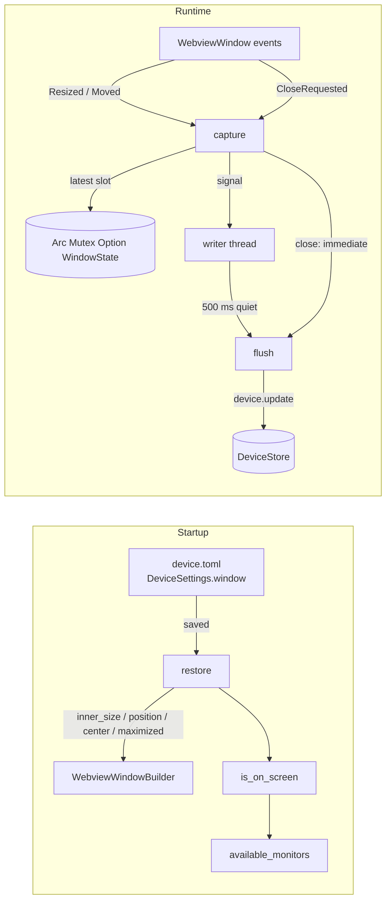
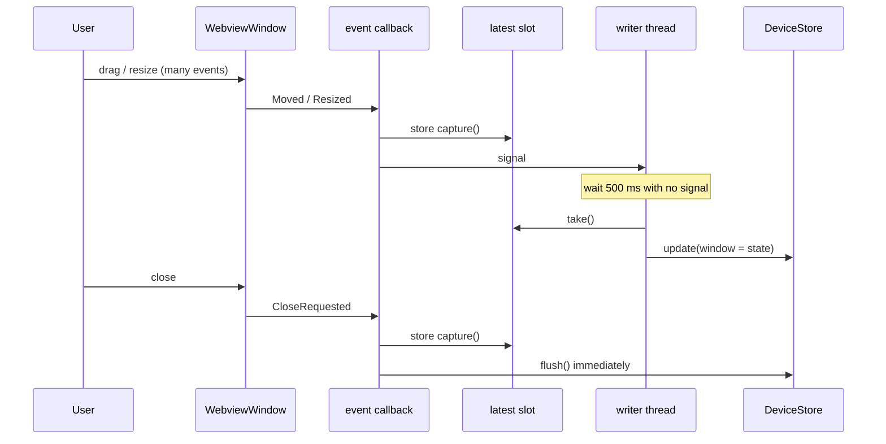
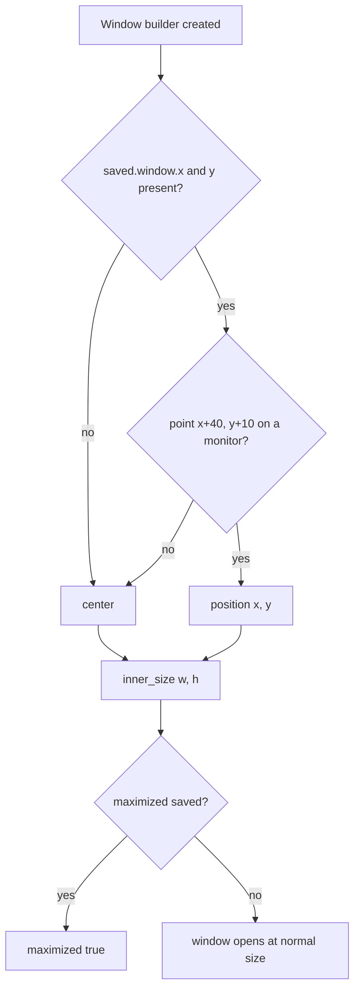

# window_state

## Introduction

`window_state` is the desktop-only part of the Tauri host that remembers the main window's geometry between launches. On startup it applies the saved size, position and maximized flag to the window builder, and while the app runs it watches move and resize events and writes the latest geometry back to the device settings file (`device.toml`), debounced so that a drag does not cause one write per pixel. It is a small, self-contained module with two public entry points: `restore` (used when the window is created) and `track` (used once the window exists). The module is compiled into the Tauri shell in `src-tauri/src/`, and its state lives in the device-local settings store from the core crate, so it never syncs to other devices.

For how the window is built and where these functions are called from, see [app_shell](app_shell.md). For the shared lock helper used by the module, see the `state` section of the same page. For the device settings file and the `DeviceStore` API, see [Data_Foundation](../Data_Foundation.md).

## Responsibilities

| Concern | Handled by |
|---|---|
| Apply saved size and maximized flag at launch | `restore` |
| Fall back to centred window when saved position is off-screen | `restore` → `is_on_screen` |
| Read current geometry from the live window | `capture` |
| Persist geometry on move/resize (debounced, 500 ms) | `track` and its writer thread |
| Persist geometry immediately on close | `track` (`CloseRequested` branch) |
| Keep the last normal-state size and position while maximized, minimized or fullscreen | `capture` |

The module does not validate the saved values beyond the on-screen check and the pixel clamps. It does not read or write any other device setting.

## Architecture

Two paths feed the same `latest` slot. The event callback overwrites it on every move or resize and sends a unit signal over an `mpsc` channel. A single long-lived thread waits for the first signal, then keeps draining signals until 500 ms pass with none, and only then writes. On `CloseRequested` the callback captures the geometry and calls `flush` directly, so the final state is written before the process exits even if the debounce timer has not fired.

## Component reference

### `restore`

Signature: `restore(handle, builder, saved) -> WebviewWindowBuilder`

Applied in this order:

1. `inner_size` is set from `saved.window.w` and `h` (logical pixels).
2. If both `x` and `y` are stored and the point `(x + 40, y + 10)` lies inside a connected monitor, the window is placed at `(x, y)`. Otherwise it is centred. The offset means the window's title bar, not its corner, must be visible.
3. `maximized` is applied last, so a window that was maximized reopens maximized at its restored normal size.

`restore` only prepares a builder. It has no effect on a window that already exists.

### `is_on_screen` (private)

Returns `false` when `available_monitors()` fails, which makes `restore` fall back to centring. Otherwise it checks each monitor's rectangle, converted to logical units with that monitor's scale factor. A window saved on a display that has since been unplugged therefore opens centred on the current display instead of off-screen.

### `capture` (private)

Reads the live window and returns a new `WindowState`.

- If the window is maximized, minimized or fullscreen, only `maximized` is updated and the stored size and position are kept. This prevents a maximized window's full-screen size from replacing the normal size the user will return to.
- Otherwise `maximized` is cleared, and `w`, `h`, `x` and `y` are read from the window in logical units. Failures to read a value leave the previous value in place.

Sizes go through `to_px` (rounded, at least 1). Positions go through `to_coord` (rounded, clamped to `i32`), because monitors left of or above the primary display have negative coordinates.

### `track`

Signature: `track(window, device: Arc<DeviceStore>)`

Registers the save logic on a window. It does three things:

- Creates the shared `latest: Arc<Mutex<Option<WindowState>>>` slot and an `mpsc` channel.
- Spawns one writer thread. The thread blocks on `recv`, then drains further signals with `recv_timeout(DEBOUNCE)` until a quiet period elapses, then calls the flush closure once. If the channel disconnects it flushes and exits.
- Registers `on_window_event`:
  - `Resized` or `Moved`: capture (using the pending value if one exists, else the stored `device.get().window`), store it in `latest`, and send a signal.
  - `CloseRequested`: the same capture, then an immediate `flush()`. The window is not prevented from closing.
  - Other events are ignored.

The flush closure takes the pending state out of `latest` (`take()`), so each write stores only the newest geometry, and calls `device.update(|d| d.window = state)`. A failed write is logged with `tracing::warn!` and dropped; the next move or resize tries again.

## Data flow

## Process flow: launch

Note that `inner_size` is applied before the position branch in the code, but both are builder settings, so the order in the diagram reflects the effect rather than the call sequence.

## Integration

- **Caller:** the app shell creates the main window, calls `restore` with the device settings it has already loaded, and calls `track` on the built window. See [app_shell](app_shell.md).
- **Settings store:** `DeviceSettings.window` (type `WindowState`, fields `w`, `h`, `x`, `y`, `maximized`) lives in `mnemora_core::device`. The store is the device-local `device.toml`, separate from the synced data described in [Data_Foundation](../Data_Foundation.md). Window geometry is not sent by the sync engine ([Sync_Replication_Engine](../Sync_Replication_Engine.md)).
- **Locking:** `lock` from `crate::state` is a poison-tolerant wrapper around `Mutex::lock`, used for the `latest` slot. Its behaviour is described in [app_shell](app_shell.md).
- **Platform scope:** the module uses desktop window APIs (`WebviewWindow`, monitors). Android does not create a resizable window, so this code path is not used there; the Android shell is in [Android_Integration](../Android_Integration.md).

## Edge cases and behaviour notes

- **Off-screen saved position:** falls back to centring; the saved size is still applied.
- **Maximized or minimized at close:** the last normal size and position are written, not the maximized ones.
- **Negative coordinates:** allowed; monitors placed left of or above the primary display produce them.
- **Rapid drags:** only the last geometry in a quiet period is written.
- **Write failure:** logged as a warning; not retried until the next move, resize or close.
- **Missing position:** a saved state with `x` or `y` unset is centred.
- **Monitor query failure:** treated as "not on screen", so the window is centred.

## Testing

The module has no unit tests of its own in the file list. Its behaviour depends on live window and monitor state, so it is not covered by the Rust test suites in `src-tauri/src/` (for example `sync_*_tests.rs` or `widget_tests.rs`). Changes should be checked by hand: move the window, resize it, maximize and restore, quit, and relaunch; then repeat with the window dragged onto a secondary monitor that is then disconnected.

## Maintenance notes

- Change `DEBOUNCE` (currently 500 ms) only with a manual check that a drag produces a small number of writes.
- Any new `WindowState` field must be captured in `capture`, otherwise it will be carried forward from `previous` unchanged.
- The 40 × 10 pixel margin in `is_on_screen` is a heuristic for "the title bar is reachable"; change it together with the centring fallback.
