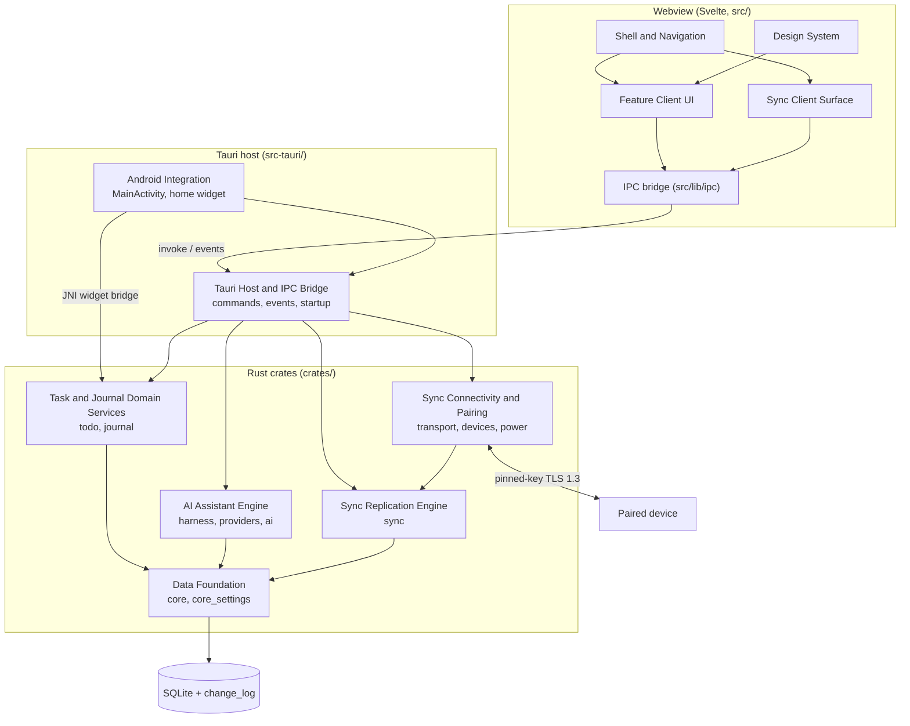
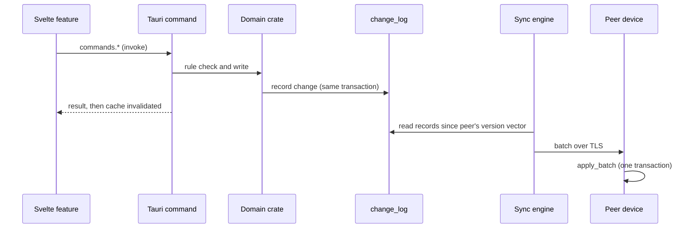

# Mnemora_v1 Overview

## Purpose

Mnemora is a personal, local-first app for keeping a **Journal**, managing **Tasks**, and asking an **AI assistant** questions about that data. It targets macOS and Android. All data stays on the person's devices. Their own devices sync directly with each other, with no server in the middle (ADR 0017). Sync is off by default.

The repository has three parts:

- **`crates/`**: a Rust workspace of domain crates (`core`, `journal`, `todo`, `sync`, `ai`, `harness`, `providers`). These hold all business rules.
- **`src/`**: the Svelte and TypeScript webview, which handles screens, navigation, and the design system.
- **`src-tauri/`**: a thin Tauri 2 host that wires the crates to the webview, plus the Android Gradle project under `gen/android`.

Supporting folders are `scripts/` (signing, icons, environment wrappers) and `docs/` (module documentation).

## Architecture

Every shared write goes through the change log in the same transaction. Sync reads that log to replicate changes.

### Request and sync flow

## Module documentation

| Module | Purpose | Documentation |
|---|---|---|
| Data Foundation | Module trait, change log, migrations, settings registry, upgrade tests | [Data_Foundation.md](Data_Foundation.md) |
| Task and Journal Domain Services | Task, List and Comment rules; read views; Task sheet behaviour | [Task_and_Journal_Domain_Services.md](Task_and_Journal_Domain_Services.md) |
| AI Assistant Engine | Provider-agnostic agent loop, read-only Tools, Conversations, Providers | [AI_Assistant_Engine.md](AI_Assistant_Engine.md) |
| Sync Replication Engine | Field merge, text merge, atomic batches, Conflicts, activity log | [Sync_Replication_Engine.md](Sync_Replication_Engine.md) |
| Sync Connectivity and Pairing | Discovery, pairing, TLS, power gate, pauses | [Sync_Connectivity_and_Pairing.md](Sync_Connectivity_and_Pairing.md) |
| Sync Client Surface | Devices, Conflicts and Activity screens; Sync switch and pause banners | [Sync_Client_Surface.md](Sync_Client_Surface.md) |
| Tauri Host and IPC Bridge | Startup order, `AppState`, typed commands and events, webview bridge | [Tauri_Host_and_IPC_Bridge.md](Tauri_Host_and_IPC_Bridge.md) |
| Android Integration | Android shell, Wi-Fi lock, local network permission, Todo home widget | [Android_Integration.md](Android_Integration.md) |
| Feature Client UI | Journal, Todo, AI, Home and greeting screens | [Feature_Client_UI.md](Feature_Client_UI.md) |
| Shell and Navigation | Startup, module enablement, router, input, Settings drafts | [Shell_and_Navigation.md](Shell_and_Navigation.md) |
| Design System | Theme tokens, UI kit, date pickers, Markdown editor | [Design_System.md](Design_System.md) |
| Build and Packaging | Cargo and pnpm manifests, Makefile, Vite and Tauri config, signing and icon scripts | [Build_and_Packaging.md](Build_and_Packaging.md) |

## How it is built and run

- **Daily commands:** `make dev` runs the Vite dev server and dev menu. `make sandbox` runs the Sandbox identity. `make test` runs `cargo test` and Vitest. `make lint` runs clippy with `-D warnings`, `fmt --check`, the colour check, Biome and `svelte-check`. `make fmt` formats the code.
- **Packaging:** `make build` makes a macOS bundle with `cargo tauri build`. `make android` makes a signed arm64 APK. `make android-sandbox` makes a debug APK that installs beside Production. `make bindings` regenerates the IPC bindings.
- **Dependencies:** Rust versions are pinned exactly in `[workspace.dependencies]`, and JavaScript versions are pinned exactly in `package.json`.
- **Frontend:** Vite builds the frontend, and the build is embedded in the Tauri binary at compile time, so the frontend must be built before a Rust release build.

For the full target table, signing flow, Android Gradle setup and configuration files, see [Build_and_Packaging.md](Build_and_Packaging.md). For the crate and module layout, see the module documents above.